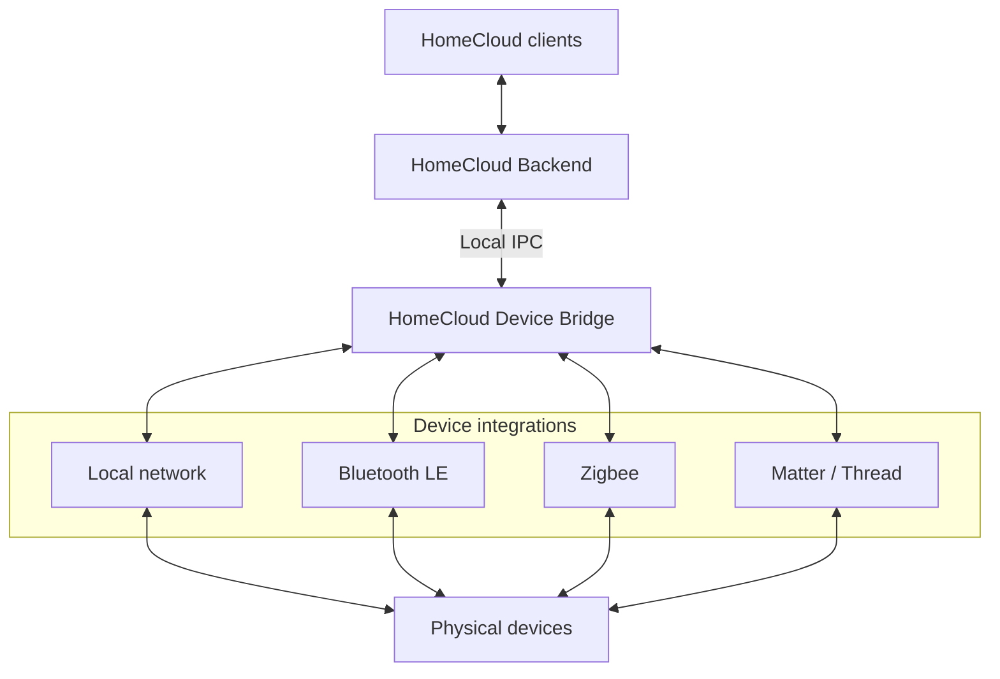

# HomeCloud Device Bridge

**The device connectivity layer for [ByteWizard HomeCloud](https://github.com/DaniilGavrin).**

HomeCloud Device Bridge is a standalone Go service responsible for discovering, connecting to, and communicating with physical devices in a HomeCloud environment.

It is designed to run as a separate process on the same host as **HomeCloud Backend**. The Backend manages the Bridge lifecycle and remains the central control plane; the Bridge handles device-facing integrations.

> **Project status:** Early development. This repository currently documents the intended architecture. Protocol integrations, runtime behavior, and public interfaces are not yet available.

---

## Why Device Bridge?

Home automation devices often use different transports and protocols: local network APIs, Bluetooth Low Energy, Zigbee, Matter, and Thread.

Device Bridge provides one dedicated place for these integrations. It keeps protocol-specific code out of the Backend while giving HomeCloud a consistent way to discover devices, receive state updates, and execute commands.

The design follows a few principles:

- **Local-first:** device communication should work without a vendor cloud or permanent Internet access.
- **Self-hosted:** no mandatory manufacturer infrastructure or external account.
- **Modular:** protocol integrations are isolated behind well-defined internal interfaces.
- **Reliable:** connections, retries, timeouts, and shutdown are managed explicitly.
- **Resource-conscious:** suitable for small home servers and single-board computers.
- **Open:** no artificial hardware lock-in.

## Architecture

Device Bridge is a separate Go process, not a remote hub and not a UI component. It runs alongside HomeCloud Backend on the same machine.

*The diagram describes the target architecture. The exact IPC transport and integration interfaces are still to be finalized.*

### Responsibility boundaries

| Component | Responsibility |
|---|---|
| **HomeCloud Backend** | Device registry and source of truth, user-facing APIs, authorization, command routing, and system-wide state |
| **HomeCloud Device Bridge** | Device discovery, protocol connections, driver lifecycle, telemetry collection, and command execution |
| **Device drivers** | Protocol- and device-specific communication and data conversion |

The Bridge must not become a second device registry. Persistent device identity and the authoritative device state belong to the Backend.

## Planned capabilities

- Discover devices available through supported local integrations.
- Maintain connections to devices and monitor their availability.
- Normalize device information and state updates for the Backend.
- Receive commands from the Backend and execute them through the appropriate driver.
- Report command results and device events.
- Recover from transient connection failures.
- Shut down cleanly and release device resources.

### Planned integrations

| Integration | Scope |
|---|---|
| Local network / Wi-Fi | Devices exposing local network APIs |
| Bluetooth Low Energy | BLE peripherals and controllers |
| Zigbee | Zigbee devices through a compatible coordinator |
| Matter | Matter-compatible devices |
| Thread | Thread-based connectivity, where supported by the host and integration stack |

Integration availability depends on compatible hardware, operating-system support, and the implementation of each driver. The list is a roadmap, not a claim of current support.

## Backend communication

The Backend and Bridge communicate over a **local inter-process channel**. The preferred direction is an OS-native local transport, such as a Unix domain socket on Linux and a named pipe on Windows. A loopback network transport remains an alternative if implementation constraints require it.

The internal protocol will need to cover:

- process handshake and protocol compatibility;
- readiness and health reporting;
- device discovery and registration events;
- device state and availability updates;
- command delivery and execution results;
- graceful shutdown.

A command being delivered is not the same as a command being executed successfully. The protocol will distinguish delivery/acceptance from the final execution result.

The Bridge is expected to own the lifecycle of its active driver instances and device connections. The Backend owns the Bridge process lifecycle, including startup, readiness checks, failure detection, restart policy, and graceful termination.

## Driver model

The initial implementation is expected to use built-in Go packages compiled into the Bridge binary.

Drivers will follow explicit interfaces so integrations can evolve independently without introducing a dynamic plugin system prematurely.

This keeps deployment straightforward: one service binary, a predictable set of dependencies, and no requirement to download executable drivers at runtime.

## Security

Device Bridge is intended to operate as a local system component.

- The internal Backend channel should not be exposed to the public Internet.
- Device integrations should use local communication wherever possible.
- Secrets and pairing credentials must not be written to logs or committed to the repository.
- Drivers must validate device responses and handle malformed or unexpected input.
- Access to local devices and host resources should follow the principle of least privilege.

Authentication and authorization policy for user-facing operations remain responsibilities of the HomeCloud control plane.

## Development

The project is written in **Go**.

The repository is in its initial stage, so build instructions, configuration reference, supported Go version, and test commands will be documented once the corresponding implementation is in place.

Contributions should preserve the architecture boundaries described above. In particular, avoid moving device persistence or user-facing business logic into the Bridge.

## Roadmap

- [ ] Define the Backend ↔ Bridge protocol and compatibility strategy.
- [ ] Implement process startup, handshake, readiness, and health reporting.
- [ ] Implement graceful shutdown and supervised restart behavior.
- [ ] Add device discovery and event contracts.
- [ ] Add command delivery and execution-result handling.
- [ ] Establish the Go driver interface and lifecycle.
- [ ] Implement the first local device integration.
- [ ] Add integration tests with a Backend test peer and simulated devices.
- [ ] Document configuration, deployment, and supported hardware.

Roadmap items are planned work and may change as implementation progresses.

## Part of ByteWizard HomeCloud

HomeCloud Device Bridge is one component of the modular, self-hosted [ByteWizard HomeCloud](https://github.com/DaniilGavrin) ecosystem.

The goal is to make locally managed devices work together through a consistent control plane — without requiring a manufacturer's cloud or tying users to specific hardware.

---

**Repository:** [DaniilGavrin/HomeCloudDeviceBridge](https://github.com/DaniilGavrin/HomeCloudDeviceBridge)
