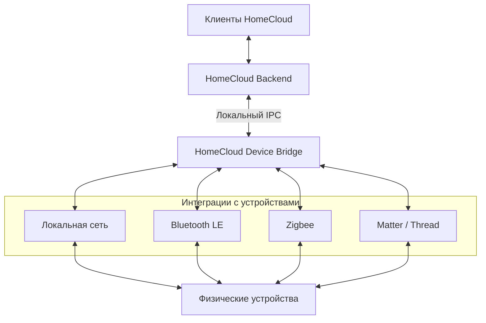

# HomeCloud Device Bridge

**Слой взаимодействия с устройствами в экосистеме [ByteWizard HomeCloud](https://github.com/DaniilGavrin).**

HomeCloud Device Bridge — отдельный сервис на Go, предназначенный для обнаружения физических устройств, установления соединений с ними и обмена данными в среде HomeCloud.

Сервис запускается отдельным процессом на том же узле, что и **HomeCloud Backend**. Backend управляет жизненным циклом Bridge и остаётся центральным управляющим компонентом системы, а Bridge отвечает за интеграцию с физическими устройствами и их протоколами.

> **Статус проекта:** ранняя стадия разработки. Сейчас репозиторий описывает целевую архитектуру. Интеграции протоколов, поведение работающего сервиса и публичные интерфейсы ещё не реализованы.

---

## Зачем нужен Device Bridge?

Устройства умного дома используют разные способы подключения и протоколы: локальные сетевые API, Bluetooth Low Energy, Zigbee, Matter и Thread.

Device Bridge объединяет интеграции с такими устройствами в отдельном сервисе. Это позволяет не переносить специфичный для каждого протокола код в Backend и предоставляет HomeCloud единый механизм обнаружения устройств, получения обновлений состояния и выполнения команд.

При разработке придерживаемся следующих принципов:

- **Локальная работа:** взаимодействие с устройствами не должно зависеть от облаков производителей или постоянного доступа в Интернет.
- **Самостоятельное размещение:** никаких обязательных внешних аккаунтов и инфраструктуры производителей.
- **Модульность:** интеграции протоколов изолированы за чётко определёнными внутренними интерфейсами.
- **Надёжность:** явное управление соединениями, повторными попытками, тайм-аутами и завершением работы.
- **Экономия ресурсов:** возможность работы на небольших домашних серверах и одноплатных компьютерах.
- **Открытость:** отсутствие искусственной привязки к определённому оборудованию.

## Архитектура

Device Bridge — отдельный процесс на Go. Это не удалённый аппаратный хаб и не компонент пользовательского интерфейса. Сервис работает на одной машине с HomeCloud Backend.

*Диаграмма показывает целевую архитектуру. Конкретный транспорт IPC и интерфейсы интеграций ещё предстоит окончательно определить.*

### Разделение ответственности

| Компонент | Ответственность |
|---|---|
| **HomeCloud Backend** | Реестр устройств и источник достоверного состояния, API для клиентов, авторизация, маршрутизация команд и общее состояние системы |
| **HomeCloud Device Bridge** | Обнаружение устройств, подключения по протоколам, жизненный цикл драйверов, сбор телеметрии и выполнение команд |
| **Драйверы устройств** | Взаимодействие с конкретными устройствами и протоколами, преобразование данных |

Bridge не должен становиться вторым реестром устройств. Постоянная идентичность устройств и авторитетное состояние хранятся в Backend.

## Планируемые возможности

- Обнаружение устройств через поддерживаемые локальные интеграции.
- Установка и поддержание соединений с устройствами, контроль их доступности.
- Приведение информации об устройствах и обновлений их состояния к единому формату для Backend.
- Получение команд от Backend и выполнение их через соответствующие драйверы.
- Передача результатов выполнения команд и событий устройств.
- Восстановление соединений после временных сбоев.
- Корректное завершение работы с освобождением ресурсов устройств.

### Планируемые интеграции

| Интеграция | Область применения |
|---|---|
| Локальная сеть / Wi-Fi | Устройства с локальными сетевыми API |
| Bluetooth Low Energy | BLE-периферия и контроллеры |
| Zigbee | Устройства Zigbee через совместимый координатор |
| Matter | Устройства, совместимые с Matter |
| Thread | Подключение устройств через Thread при наличии поддержки со стороны оборудования и программного стека |

Доступность интеграций зависит от совместимого оборудования, поддержки операционной системой и реализации соответствующих драйверов. Список отражает планы развития, а не уже реализованные возможности.

## Взаимодействие с Backend

Backend и Bridge обмениваются данными через **локальный межпроцессный канал**. Предпочтительный вариант — нативный для операционной системы локальный транспорт: например, Unix domain socket в Linux и именованный канал (named pipe) в Windows. Если этого потребуют технические ограничения, альтернативой может стать сетевое соединение через loopback-интерфейс.

Внутренний протокол должен предусматривать:

- рукопожатие процессов и согласование совместимости версий протокола;
- подтверждение готовности и передачу состояния работоспособности;
- события обнаружения и регистрации устройств;
- обновления состояния и доступности устройств;
- доставку команд и передачу результатов их выполнения;
- корректное завершение работы.

Доставка команды не означает, что устройство успешно её выполнило. Протокол должен различать факт доставки или принятия команды и итоговый результат её исполнения.

Bridge управляет жизненным циклом собственных драйверов и соединений с устройствами. Backend управляет жизненным циклом самого процесса Bridge: запуском, проверкой готовности, обнаружением сбоев, политикой перезапуска и корректным завершением.

## Модель драйверов

На первом этапе драйверы планируется реализовать в виде встроенных Go-пакетов, компилируемых непосредственно в бинарный файл Bridge.

Для драйверов будут определены явные интерфейсы, позволяющие независимо развивать интеграции без преждевременного внедрения динамической системы плагинов.

Такой подход упрощает развёртывание: один бинарный файл сервиса, предсказуемый набор зависимостей и отсутствие необходимости загружать исполняемые драйверы во время работы.

## Безопасность

Device Bridge проектируется как локальный системный компонент.

- Внутренний канал взаимодействия с Backend не должен быть доступен из публичного Интернета.
- По возможности интеграции должны использовать локальные способы взаимодействия с устройствами.
- Секреты и данные сопряжения не должны попадать в логи или в репозиторий.
- Драйверы должны проверять ответы устройств и корректно обрабатывать некорректные или неожиданные данные.
- Доступ к устройствам и ресурсам хоста должен предоставляться по принципу минимально необходимых привилегий.

Политика аутентификации и авторизации пользовательских операций остаётся ответственностью управляющего контура HomeCloud.

## Разработка

Проект написан на **Go**.

Репозиторий находится на начальном этапе. Инструкции по сборке, описание конфигурации, поддерживаемая версия Go и команды запуска тестов будут добавлены по мере появления соответствующей реализации.

При внесении изменений важно сохранять описанное выше разделение ответственности. В частности, не следует переносить в Bridge постоянное хранение данных об устройствах или бизнес-логику пользовательских операций.

## План разработки

- [ ] Определить протокол взаимодействия Backend ↔ Bridge и стратегию совместимости.
- [ ] Реализовать запуск процесса, рукопожатие, подтверждение готовности и передачу состояния работоспособности.
- [ ] Реализовать корректное завершение работы и контролируемый перезапуск.
- [ ] Определить контракты обнаружения устройств и передачи событий.
- [ ] Реализовать доставку команд и обработку результатов выполнения.
- [ ] Определить интерфейс Go-драйверов и управление их жизненным циклом.
- [ ] Реализовать первую локальную интеграцию с устройствами.
- [ ] Добавить интеграционные тесты с тестовым Backend и эмулируемыми устройствами.
- [ ] Документировать конфигурацию, развёртывание и поддерживаемое оборудование.

Пункты плана отражают текущее направление разработки и могут изменяться по мере развития проекта.

## Часть экосистемы ByteWizard HomeCloud

HomeCloud Device Bridge — один из компонентов модульной платформы с самостоятельным размещением [ByteWizard HomeCloud](https://github.com/DaniilGavrin).

Цель проекта — объединить локально управляемые устройства через единый управляющий контур, не требуя облачной инфраструктуры производителей и не привязывая пользователей к определённому оборудованию.

---

**Репозиторий:** [DaniilGavrin/HomeCloudDeviceBridge](https://github.com/DaniilGavrin/HomeCloudDeviceBridge)
